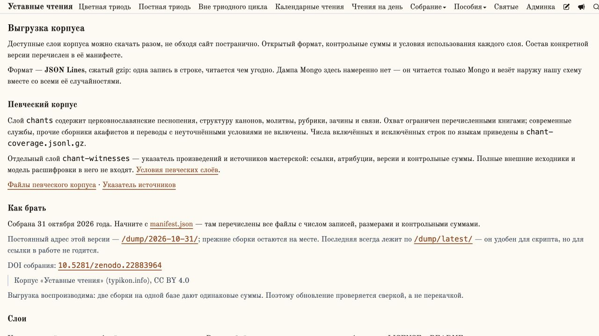

# Певческий корпус в выгрузке 6.4

В `corpus:dump` добавлены два независимых слоя: `chants` и `chant-witnesses`.
Они участвуют в общей сборке и манифесте наравне с прежними слоями. Базы открываются
только для чтения; пользовательские таблицы SQLite и внешние нотные тела не экспортируются.

`chants` содержит церковнославянские тексты из перечисленных книг, их владельцев
(группы, каноны, древний акафист, молитвы), порядок, рубрики, зачины и связи.
Публичные ID сохранены; связи между текстами включены только при наличии обоих
концов в выгрузке. Политика источников задана явно в `src/scripts/lib/chantDump.ts`:
новый язык/источник не расширяет состав молча. Охват и исключения перечислены
в `chant-coverage.jsonl.gz`, описания изданий — в `chant-editions.jsonl.gz`.

`chant-witnesses` содержит произведения и происхождение двоезнаменных свидетельств:
источники, авторские атрибуции набора, ссылки, версии и SHA256 оригиналов.
Тела `.zf`, полные книги и npm-модель не включаются: для них не подтверждена
открытая лицензия. Это отражено в README слоя, `notShipped` манифеста и `/license`.

## Сборка

```sh
# Полная выгрузка, включая новые слои; на сервере RULES_DB указывает на базу движка:
npm run corpus:dump -- --out /tmp/corpus-candidate
# Явное указание второй базы:
node --import tsx src/scripts/build-corpus-dump.ts --out /tmp/corpus-candidate --rules-db /path/to/typikon-rules/src/data.db
# Только новые слои для проверки (не полная выгрузка):
node --import tsx src/scripts/build-corpus-dump.ts --out /tmp/chants-candidate --rules-db /path/to/data.db --layers chants,chant-witnesses
```

Исходный указатель мастерской по умолчанию читается из
`data/chant-corpus/znamen-v1`; другой путь задаётся `--chant-witnesses`.
Отсутствующая/пустая певческая база или отсутствующий указатель останавливают
сборку до удаления прежнего выходного каталога. Выходной каталог задаётся отдельно
от опубликованной версии; готовый кандидат выкладывается обычным порядком.

Страница `/data` показывает ссылки и числа из фактического манифеста. Старый
манифест читается по-прежнему; если певческих слоёв в нём нет, страница прямо
говорит об этом. Новый код страницы не приписывает новые файлы прежнему архиву.
Ссылки ведут в неизменяемый каталог версии; лицензии и контрольные суммы лежат
рядом с каждым слоем. Новые слои не получают DOI прежних опубликованных слоёв.

## Проверки

Тесты политики экспорта проверяют отбор языков/источников, исключение современных
служб, сохранение связей и атрибуций, отсутствие внешних тел и модели.

```sh
node --import tsx --test src/scripts/lib/chantDump.test.ts src/scripts/lib/dumpLayers.test.ts src/lib/dump.test.ts
npm run typecheck
```

Локальные сборки и проверка страниц выполняются отдельно от продовой выкладки.

Результат 2026-10-31: полная сборка — 6 слоёв, 54 файла; все gzip, размеры,
числа записей и SHA256 проверены. Все14 новых файлов побуквенно воспроизводимы
в отдельной повторной сборке. Экспортировано95 673 текстовые позиции,1 596 канонов,
365 молитв, древний акафист Триоди и2 700 записей об источниках мастерской.
Связи замкнуты на включённых текстах; все родительские записи присутствуют.

27 тестов и проверка типов прошли. В браузере проверены новые файлы и переход
на `/license#chants`, поведение со старым манифестом и без манифеста. Все14 ссылок
скачивались через тестовую раздачу с HTTP200 и совпадающими SHA256.
[Машинный отчёт](audits/chant-dump-validation.json).


