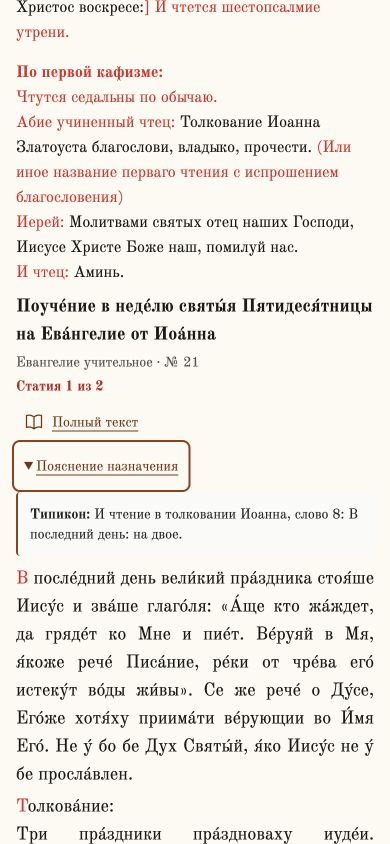

# Чтения дня: телефон и клавиатура

Изменения для6.4, проверены локально2026-10-31.

У каждого четьего текста постоянно видны название произведения, книга и номер
внутри неё. Если назначена статия, показано её число; при существующем делении
текста — например, «Статия2 из2». Когда селектор не задан, а компонент выводит
первую из нескольких частей, подпись отражает именно первую часть.

Ссылка «Полный текст» имеет доступное имя с названием произведения и ведёт по
нынешнему алиасу; при отсутствии алиаса остаётся адрес по ID. У библейской ссылки
тоже есть доступное имя. Новые ссылки и заголовки пояснений — не менее44 px по высоте.

Цитата Типикона раскрывается через «Пояснение назначения» отдельно для каждого
назначения. Используется нативное `details/summary`: нажатие, Enter и пробел
работают без наведения; Escape закрывает пояснение и возвращает фокус на его
заголовок. Tab и Shift+Tab следуют обычному порядку страницы, без захвата фокуса.
Пустой цитате не соответствует пустая кнопка. Уставные пометы `description`
(в том числе календарные условия) остаются непосредственно рядом с текстом.

Порядок, состав и границы чтений не менялись. Разбор существующих маркеров
`[Среда:]` / `[Статия N]` вынесен в общий чистый helper; он используется и для
выбора тела, и для подписи статии. В оглавлении на телефоне снято ограничение
ширины до четверти экрана; основной столбец может сжиматься без переполнения.
Изменение общего компонента действует в калькуляторе, календарных и подвижных
чтениях, включая страницы шаблонов.

## Проверка

На реальных чтениях Пятидесятницы, `/calculator/2026-05-31`, подтверждены:

- Одинаковое произведение Учительного21 подписано отдельно как статии1/2.
- Нажатие открывает цитату; два пояснения независимы.
- Tab переходит со ссылки полного текста на пояснение; Enter открывает,
  пробел закрывает, Escape закрывает и возвращает фокус.
- Следующий Tab уходит к следующему чтению. Обводка клавиатурного фокуса —2 px.
- Области «Полный текст» и «Пояснение назначения» имеют высоту44 px.
- При360,390,768,1280 px ширина документа равна ширине экрана, включая открытое пояснение.
- Переход клавиатурой ведёт на `/reading/pouchenie-na-pyatidesyatnicu`;
  там присутствуют название и обе части произведения.

Повторно проверены все33 ранее валидированных назначения через реальную
агрегацию, API и серверный HTML: полный выбранный текст совпал с источником
в33/33 случаях. Статии Мироносиц и Вознесения покрывают обе исходные части.
Это техническая регрессия интерфейса; исходные редакторские выводы не переоценивались.

Новые тесты проверяют видимый заголовок, статию, ссылки, отсутствие пустых
пояснений, две части одного текста и доступное имя библейского перехода.
Профильные проверки зачал, непрерывных чтений и сериализации API также выполнены:
48/48 тестов, проверка типов пройдена.
[Машинный отчёт](audits/day-readings-mobile-validation.json).

```sh
node --import tsx --test src/app/components/DayPartReading.test.ts src/lib/easterVespers.test.ts src/lib/continuousReading.test.ts src/lib/liturgicalText.test.ts src/lib/liturgicalEnding.test.ts src/lib/api/v2/serialize.test.ts
npm run typecheck
```

Ограничение: проверены узкое окно браузера, указатель и клавиатура; отдельной
проверки на физическом телефоне со скринридером не было. Выкладка не выполнялась.


