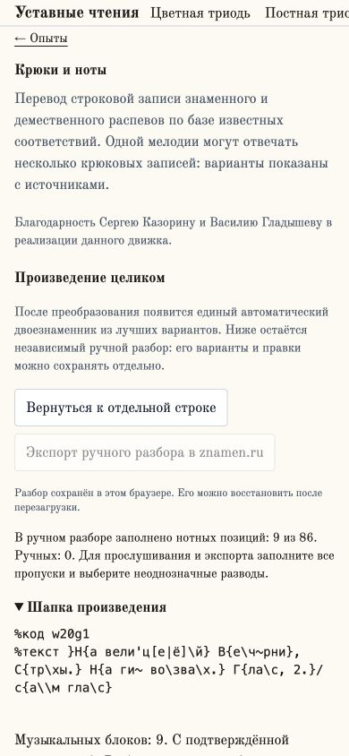
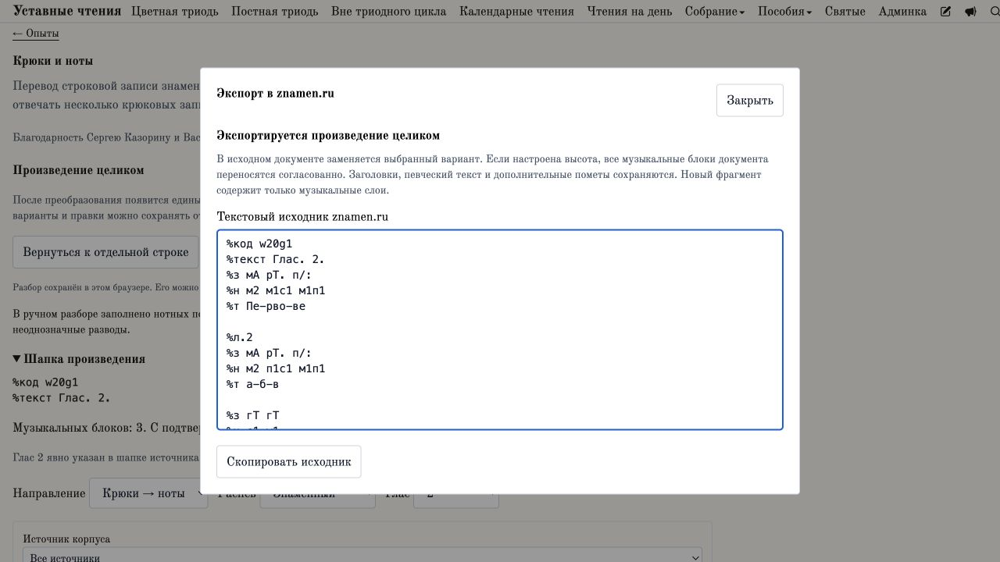
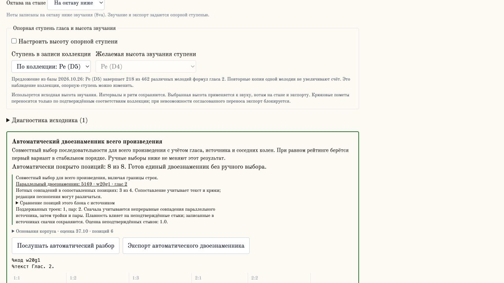

# 6.4: проверка певческой мастерской

Локальный проход 2026-10-31, пакет `@znamenica/kruczie@1.0.0`, страница
`/opyty/kruczie`. Прод не проверялся. Это выполненная часть проверки мастерской,
а не подтверждение готовности всех её сценариев.

| Проверка | Результат |
| --- | --- |
| Автоматические проверки музыкальной логики, корпуса, импорта/экспорта и целого произведения | 84/84 теста прошли: `node --import tsx --test src/lib/kruczie/*.test.ts src/lib/kruczie/corpus/*.test.ts` |
| Типы после исправления интерфейса | `npm run typecheck` прошёл |
| Импорт полного «Первовечному», w20g1, без высотных помет | В браузере распознаны 9 блоков и 86 позиций, привязка подтверждена во всех 9 блоках; глас2 выбран из шапки |
| Преобразование целого произведения в worker | Обработка дошла до 9/9; появился автоматический двоезнаменник. Это не утверждение о полноте или музыкальной правильности всех предложенных разводов |
| Восстановление сохранённого произведения | В свежей вкладке восстановились 9 блоков, шапка, подвал и глас2. В ручном разборе 9/86 нотных позиций; пропуски не объявлены заполненными |
| Пояснения к происхождению и ограничениям | Видны версия корпуса, источник, неоднозначность, запасные варианты вне гласа и ограниченность поиска; шапка и подвал отделены от перевода |
| Узкий экран | Найдено и исправлено переполнение списка источников. До исправления на390 px ширина документа501 px, select доходил до501 px; после — документ390 px, правая граница select361 px |
| Повторные размеры после исправления | При ширинах360,390,768,1280 px ширина документа равна ширине экрана; проверена также страница восстановленного целого произведения |

Исправление в `CorpusControls.tsx`: список занимает доступную ширину, может
сжиматься и ограничен шириной контейнера. Горизонтальная прокрутка музыкальных
рядов остаётся внутри этих рядов.

При повторном чтении большой страницы со всеми вариантами после горячего
обновления инструментарий браузера один раз превысил время ожидания. Причина
не установлена; это не записано как подтверждённая ошибка приложения.
Проверка исправленной ширины и восстановления выполнена в свежей вкладке.

## Прослушивание, полный экспорт и повторный импорт — 2026-10-31

Проверка пройдена в локальном браузере; код плеера и экспорта менять не потребовалось.
Ниже — проверенные сценарии, а не только результаты библиотечных тестов.

| Сценарий | Подтверждение |
| --- | --- |
| Полное прослушивание двоезнаменника w10g1 | 8 блоков, 50 слоговых позиций, 87 нот; кнопка остановки и движущаяся подсветка текущей ноты |
| Остановка и смена темпа96→132 | Плеер вернулся к запуску, подсветка снялась; расчётная длительность изменилась с89,375 до65 секунд без изменения нот |
| Переключение с блока на целое произведение | Кнопка блока вернулась к запуску, активным стало целое произведение |
| Естественное завершение блока8 | Восстановилась кнопка запуска, подсветка снялась |
| Экспорт во время проигрывания и выход из произведения | Воспроизведение остановлено; подсветка снялась. Проверено также для автоматического результата |
| Полный ручной экспорт → копирование → повторный импорт → экспорт | Все8 блоков и50 позиций сохранились. Оба экспорта и буфер копирования побуквенно равны входу формы; SHA256 обоих экспортов совпадает с исходным |
| Автоматическое дополнение нот и повторный импорт | Контрольный документ из3 блоков и8 позиций: добавлены только две строки `%н`; крюки, слоги и их разделители не изменились; третий блок с существующими нотами сохранён побуквенно |
| Шапка, страницы и подвал | Сохранены BOM, `%код`, `%текст`, `%л.2`/`%л.8`/`%л.9`, `%Разница` и неизвестная директива; после повторного импорта они не исчезли и не стали музыкальными блоками |
| Неразмеченный блок | Ручной и автоматический полный экспорт/проигрывание заблокированы; исходный блок показан и сохранён, пропуск не заменён паузой |
| Ошибки браузера и проверки кода | Ошибок в консоли нет; 34/34 профильных теста повторно прошли, `npm run typecheck` прошёл |

Контрольный документ для автоматического экспорта использует две известные
трёхпозиционные формулы и третий блок с готовыми нотами. Это проверка добавления
слоя и сохранности документа, а не дополнительное целое историческое песнопение.

Браузерное поле ввода нормализует CRLF в LF ещё до разбора. Побуквенное сравнение
начинается с фактического значения этого поля; это не обещание сохранить окончания
строк файла при вставке в textarea. Отдельно проверен библиотечный экспорт с BOM
и CRLF: он сохраняет исходную строку целиком.

Звук проверен по состояниям плеера, движению нотного курсора, завершению и отмене;
акустическое звучание на слух не оценивалось. Историческая правильность
автоматически выбранного развода этой проверкой не устанавливается.

[Машинный результат с хешами и браузерными наблюдениями](audits/workshop-roundtrip/validation.json).
Рядом сохранены входы, оба экспорта каждого сценария и скриншот. Их можно независимо
сравнить и проверить действующим парсером:

```sh
node --import tsx src/scripts/verify-workshop-roundtrip.ts docs/audits/workshop-roundtrip > /tmp/workshop-roundtrip-review.json
node --import tsx --test src/lib/kruczie/work.test.ts src/lib/kruczie/automaticWork.test.ts src/lib/kruczie/workDraft.test.ts src/lib/kruczie/playback.test.ts src/lib/kruczie/znamen.test.ts src/lib/kruczie/transposition.test.ts
```

Первый скрипт повторно проверяет сохранённые артефакты; он не запускает браузер
и не заменяет свежую проверку интерфейса после его изменения.

## Production-worker, отмена и переключения — 2026-10-31

В отдельной временной копии выполнена **production-компиляция Next.js14.2.35**:
`next build --experimental-build-mode compile`, затем `next start` на
`127.0.0.1:3104`. Существующая dev-сборка не перезаписывалась. Генерация статических
страниц этим режимом не запускается: это проверка production-клиента и worker,
а не полный релизный прогон всего сайта.

Проверены оба worker: перевод отдельной строки и обработка произведения.
Оптимизированные файлы выданы с HTTP200; SHA256 ответов совпал с файлами сборки.
Перевод строки дал ожидаемые ноты, новый запуск произведения дошёл до3/3 блоков
и8/8 позиций; экспорт побуквенно совпал с сохранённым dev-результатом.

В обеих сборках отменена обработка9 блоков во время начальной загрузки:
прогресс0/9 не изменился после отмены, запоздалый результат не появился, новый
запуск доступен. В production отдельно остановлен контрольный документ из20
блоков после4/20: найденные результаты сохранились, позднего продвижения нет.
Во время следующего запуска выполнен переход по ссылке «Опыты»; страница и её
управление сменились без ошибок браузера. Это наблюдение интерфейса вместе с
проверкой обработчиков очистки; внутреннее состояние AudioContext после перехода
отдельно не измерялось.

В dev проверены выбор другого варианта блока при проигрывании и переход из
мастерской по ссылке: кнопка вернулась в исходное состояние, подсветка снялась.
Встроенный демественный пример прошёл в обе стороны: `пЭ-;` ↔ `с1м1п4`.
Это пример, а не проверка полного демественного песнопения.

При подготовке временной копии выявлена зависимость от runtime-корпуса:
`data/chant-corpus/znamen-v1/parallel-index.json` и файлов указанных свидетелей.
Без этой папки API возвращает503, worker использует запасной подбор, и одна
нотная строка контрольного результата отличалась. После переноса того же корпуса
и перезапуска тестового сервера результат совпал. Файлы корпуса включены в git;
при подготовке изолированной сборки необходимо переносить также каталог `data`,
а не только `src` и `public`. Первичный сбой загрузки Inter в ограниченном
окружении устранён повторной сборкой с сетевым доступом к Google Fonts.

[Браузерные наблюдения и проверки](audits/workshop-production/validation.json),
[идентификатор сборки, хеши исходников, worker и корпуса](audits/workshop-production/build.json),
[production-экспорт](audits/workshop-production/production-export.txt).
Код мастерской в этом проходе не менялся.

Осталось в этом пункте релиза:

- Прослушивание на слух, другие целые песнопения и демественный распев;
  два проверенных знаменных произведения не покрывают весь корпус.
- Мобильное устройство с сенсорным вводом и Safari: размеры окна браузера
  не заменяют эти проверки. Полная стандартная сборка сайта остаётся частью
  подготовки релиза; production-worker уже проверен в compile-режиме.






